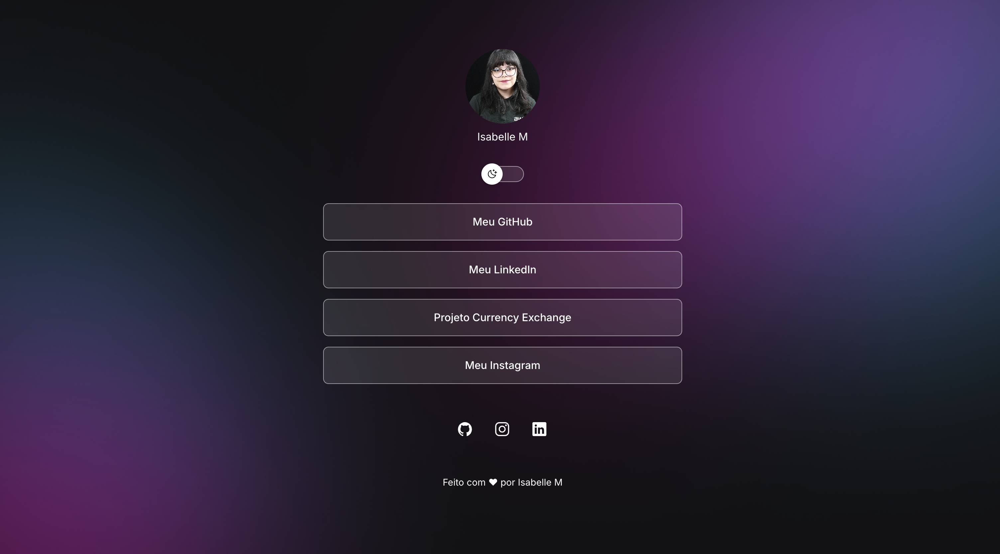
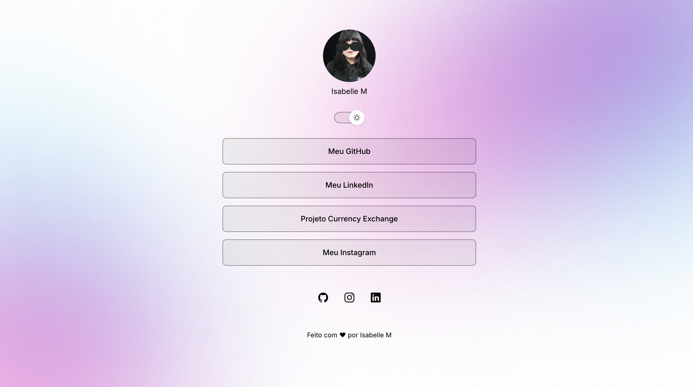
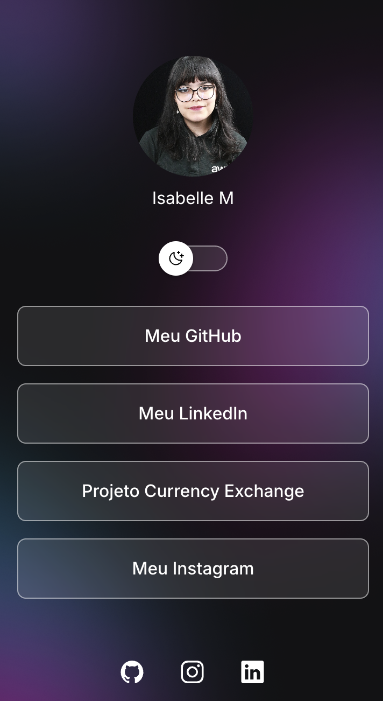
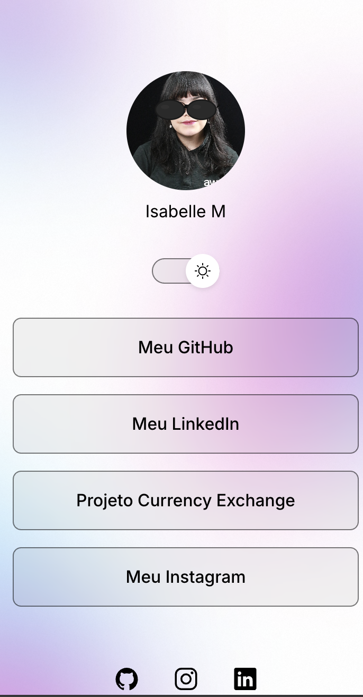

# Capturas da versão personalizada

Capturas feitas manualmente por Isabelle no navegador em 10/11/2026, com o app rodando em `npm run dev`. Não foram geradas por Playwright.

| Tela | Tema escuro | Tema claro |
|---|---|---|
| Desktop | [desktop-escuro.png](desktop-escuro.png) | [desktop-claro.png](desktop-claro.png) |
| Celular | [celular-escuro.png](celular-escuro.png) | [celular-claro.png](celular-claro.png) |

## O que as capturas mostram
- Foto e nome "Isabelle M" no topo.
- Seletor de tema: lua no escuro, sol no claro.
- No tema claro, os óculos escuros aparecem sobre a foto, na altura dos olhos.
- Quatro links: Meu GitHub, Meu LinkedIn, Projeto Currency Exchange e Meu Instagram.
- Ícones de GitHub, Instagram e LinkedIn.
- Nas capturas de desktop aparece o rodapé "Feito com ♥ por Isabelle M". Nas de celular, a imagem termina nos ícones sociais e o rodapé fica fora do enquadramento.

